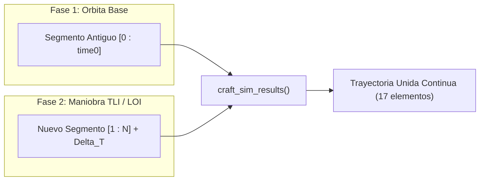

# Manual Técnico y Arquitectura del Sistema - NuevoCohete

> **Propósito del Documento:** Servir como referencia técnica exhaustiva y base de contexto persistente para desarrollo, análisis, mantenimiento y extensión del simulador espacial **NuevoCohete**.

---

## 1. Visión General del Proyecto

**NuevoCohete** es una plataforma científica y numérica desarrollada en Python orientada al diseño, análisis y simulación de trayectorias aeroespaciales en el régimen cislunar (Tierra-Luna).

El simulador combina:
- **Modelado físico de precisión:** Problema restringido de tres cuerpos circulares/elípticos (Tierra, Luna y vehículo espacial) integrados numéricamente.
- **Dinámica de propulsión de cohetes:** Encendidos vectoriales multi-etapa configurables en orientación esférica ($\theta, \beta$) con consumo continuo de masa según la ecuación de Tsiolkovsky.
- **Herramientas de astrodinámica orbital:** Solvers para inyección translunar (TLI), inserción en órbita lunar (LOI), cálculo de ventanas de fase (*lead angles*) y análisis de puntos de interés (POIs).
- **Simulación multi-fase por costura (*trajectory stitching*):** Capacidad de ramificar, extender y concatenar fases consecutivas manteniendo la continuidad física del vector de estado.
- **Visualización 3D y renderizado multimedia:** Vistas geocéntricas y selenocéntricas con texturas planetarias mapeadas, telemetría sincronizada y exportación de video MP4/GIF.
- **Simulaciones paramétricas por lotes (*batch runs*):** Barrido de variables físicas o de encendido con gráficos comparativos de dispersión.

---

## 2. Mapa Integral del Código Fuente

| Archivo | Rol Principal | Componentes y Funciones Clave |
| :--- | :--- | :--- |
| [`main.py`](file:///C:/Users/fcola/Desktop/NuevoCohete/main.py) | Orquestador principal de interfaz CLI y flujo de misiones | [`menu`](file:///C:/Users/fcola/Desktop/NuevoCohete/main.py#L877), [`menu_sim_admin`](file:///C:/Users/fcola/Desktop/NuevoCohete/main.py#L374), [`ran_new_sim`](file:///C:/Users/fcola/Desktop/NuevoCohete/main.py#L15), [`craft_sim_results`](file:///C:/Users/fcola/Desktop/NuevoCohete/main.py#L58), [`ran_iter_sim`](file:///C:/Users/fcola/Desktop/NuevoCohete/main.py#L123), [`perform_tli_sequence`](file:///C:/Users/fcola/Desktop/NuevoCohete/main.py#L302), [`_execute_batch_run`](file:///C:/Users/fcola/Desktop/NuevoCohete/main.py#L190). |
| [`modelo_3d.py`](file:///C:/Users/fcola/Desktop/NuevoCohete/modelo_3d.py) | Motor físico y solución de ecuaciones diferenciales | [`calc_sim`](file:///C:/Users/fcola/Desktop/NuevoCohete/modelo_3d.py#L159), [`equations_of_motion`](file:///C:/Users/fcola/Desktop/NuevoCohete/modelo_3d.py#L84), [`get_thrust_vector`](file:///C:/Users/fcola/Desktop/NuevoCohete/modelo_3d.py#L21), [`get_mass_flow_rate`](file:///C:/Users/fcola/Desktop/NuevoCohete/modelo_3d.py#L60). |
| [`calc_luna.py`](file:///C:/Users/fcola/Desktop/NuevoCohete/calc_luna.py) | Algoritmos de astrodinámica, solvers TLI/LOI y marcos locales | [`find_moon_intercept`](file:///C:/Users/fcola/Desktop/NuevoCohete/calc_luna.py#L5), [`calculate_loi`](file:///C:/Users/fcola/Desktop/NuevoCohete/calc_luna.py#L175), [`calculate_encounter_prediction`](file:///C:/Users/fcola/Desktop/NuevoCohete/calc_luna.py#L452), [`search_best_encounter_window`](file:///C:/Users/fcola/Desktop/NuevoCohete/calc_luna.py#L569), [`analyze_trajectory_pois`](file:///C:/Users/fcola/Desktop/NuevoCohete/calc_luna.py#L658), [`calculate_maneuver_vector`](file:///C:/Users/fcola/Desktop/NuevoCohete/calc_luna.py#L767), [`vector_to_angles`](file:///C:/Users/fcola/Desktop/NuevoCohete/calc_luna.py#L740). |
| [`new_sim.py`](file:///C:/Users/fcola/Desktop/NuevoCohete/new_sim.py) | Modelo de configuración, presets orbitales y asistente por lotes | [`ConfigSim`](file:///C:/Users/fcola/Desktop/NuevoCohete/new_sim.py#L8), [`config`](file:///C:/Users/fcola/Desktop/NuevoCohete/new_sim.py#L81), [`config_manual`](file:///C:/Users/fcola/Desktop/NuevoCohete/new_sim.py#L284), [`config_high_dv_orbit`](file:///C:/Users/fcola/Desktop/NuevoCohete/new_sim.py#L314), [`config_400km_moon_plane`](file:///C:/Users/fcola/Desktop/NuevoCohete/new_sim.py#L364), [`config_from_sim_silent`](file:///C:/Users/fcola/Desktop/NuevoCohete/new_sim.py#L158), [`config_batch`](file:///C:/Users/fcola/Desktop/NuevoCohete/new_sim.py). |
| [`grf_data.py`](file:///C:/Users/fcola/Desktop/NuevoCohete/grf_data.py) | Mapeo de texturas, proyecciones 3D, telemetría y animación | [`process_data`](file:///C:/Users/fcola/Desktop/NuevoCohete/grf_data.py#L55), [`graf_all`](file:///C:/Users/fcola/Desktop/NuevoCohete/grf_data.py#L129), [`plot_sistema_completo`](file:///C:/Users/fcola/Desktop/NuevoCohete/grf_data.py#L159), [`plot_close_up_tierra`](file:///C:/Users/fcola/Desktop/NuevoCohete/grf_data.py#L196), [`plot_moon_centered`](file:///C:/Users/fcola/Desktop/NuevoCohete/grf_data.py#L239), [`plot_datos_telemetria`](file:///C:/Users/fcola/Desktop/NuevoCohete/grf_data.py), [`animar_simulacion`](file:///C:/Users/fcola/Desktop/NuevoCohete/grf_data.py#L524), [`plot_batch_telemetria`](file:///C:/Users/fcola/Desktop/NuevoCohete/grf_data.py), [`plot_batch_closeup`](file:///C:/Users/fcola/Desktop/NuevoCohete/grf_data.py#L453). |
| [`archivo_new.py`](file:///C:/Users/fcola/Desktop/NuevoCohete/archivo_new.py) | Serialización de simulaciones en `.npz` y gestión de correlativos | [`guardar_simulacion`](file:///C:/Users/fcola/Desktop/NuevoCohete/archivo_new.py#L35), [`get_next_sim_name`](file:///C:/Users/fcola/Desktop/NuevoCohete/archivo_new.py#L8). |
| [`archivo_open.py`](file:///C:/Users/fcola/Desktop/NuevoCohete/archivo_open.py) | Deserialización, objeto de administración y retrocompatibilidad | [`AdminResultasosSim`](file:///C:/Users/fcola/Desktop/NuevoCohete/archivo_open.py#L7), [`getdata`](file:///C:/Users/fcola/Desktop/NuevoCohete/archivo_open.py#L51). |
| [`test_integration_moon.py`](file:///C:/Users/fcola/Desktop/NuevoCohete/test_integration_moon.py) | Prueba integral de rama silenciosa y optimizador TLI | [`test_integration`](file:///C:/Users/fcola/Desktop/NuevoCohete/test_integration_moon.py#L42). |
| [`verify_400km.py`](file:///C:/Users/fcola/Desktop/NuevoCohete/verify_400km.py) | Verificación orbital circular coplanar a 400 km | [`test_400km_sim`](file:///C:/Users/fcola/Desktop/NuevoCohete/verify_400km.py#L5). |
| [`verify_animation.py`](file:///C:/Users/fcola/Desktop/NuevoCohete/verify_animation.py) | Validación de renderizado de video MP4/GIF sin backend gráfico Qt | [`test_animation`](file:///C:/Users/fcola/Desktop/NuevoCohete/verify_animation.py#L7). |
| [`debug_tli.py`](file:///C:/Users/fcola/Desktop/NuevoCohete/debug_tli.py) | Script de prueba para validación numérica de TLI desde LEO y órbitas elípticas | Casos de prueba 1, 2 y 3. |

---

## 3. Fundamentos Físicos y Matemáticos

### 3.1 Marco de Referencia y Constantes
- **Sistema de Coordenadas:** Centrado en la Tierra (ECI - *Earth-Centered Inertial*), con coordenadas cartesianas $(X, Y, Z)$ en metros y velocidades $(V_x, V_y, V_z)$ en m/s.
- **Constantes Estándar:**
  - Gravitación Universal: $G = 6.67430 \times 10^{-11} \text{ N m}^2/\text{kg}^2$
  - Masa de la Tierra: $M_\oplus = 5.972 \times 10^{24} \text{ kg}$
  - Radio medio de la Tierra: $R_\oplus = 6,378,137.0 \text{ m}$ (en gráficos se utiliza $6,357,000 \text{ m}$)
  - Parámetro gravitacional terrestre: $\mu_\oplus = G M_\oplus \approx 3.986004418 \times 10^{14} \text{ m}^3/\text{s}^2$
  - Masa de la Luna: $M_{\text{Luna}} = 7.342 \times 10^{22} \text{ kg}$
  - Radio medio de la Luna: $R_{\text{Luna}} = 1,737,400.0 \text{ m}$
  - Parámetro gravitacional lunar: $\mu_{\text{Luna}} = G M_{\text{Luna}} \approx 4.9028 \times 10^{12} \text{ m}^3/\text{s}^2$
  - Aceleración estándar de gravedad al nivel del mar: $g_0 = 9.80665 \text{ m/s}^2$

### 3.2 Vector de Estado y Ecuaciones Diferenciales
El integrador resuelve simultáneamente el estado del vehículo espacial (7 grados de libertad: posición, velocidad y masa) y la Luna (6 grados de libertad: posición y velocidad):

$$y(t) = [r_x, r_y, r_z, v_x, v_y, v_z, m, x_L, y_L, z_L, v_{xL}, v_{yL}, v_{zL}]^T \in \mathbb{R}^{13}$$

#### Dinámica del Cohete:
$$\frac{d\vec{r}}{dt} = \vec{v}$$

$$\frac{d\vec{v}}{dt} = \vec{a}_{g,\oplus} + \vec{a}_{g,\text{Luna}} + \vec{a}_{\text{thrust}}$$

Donde:
1. **Atracción Gravitacional Terrestre:**
   $$\vec{a}_{g,\oplus} = -\frac{\mu_\oplus}{||\vec{r}||^3} \vec{r}$$
2. **Atracción Gravitacional Lunar (Tercer Cuerpo):**
   $$\vec{r}_{\text{rel}} = \vec{r} - \vec{r}_L$$
   $$\vec{a}_{g,\text{Luna}} = -\frac{\mu_{\text{Luna}}}{||\vec{r}_{\text{rel}}||^3} \vec{r}_{\text{rel}}$$
3. **Aceleración por Empuje:**
   $$\vec{a}_{\text{thrust}} = \frac{\vec{F}_T(t)}{m(t)}$$
4. **Variación de Masa:**
   $$\frac{dm}{dt} = -\sum_{i=1}^{N_{\text{activos}}} \frac{F_{T,i}}{g_0 \cdot I_{sp,i}}$$

#### Dinámica de la Luna (Orbital alrededor de la Tierra):
$$\frac{d\vec{r}_L}{dt} = \vec{v}_L, \quad \frac{d\vec{v}_L}{dt} = -\frac{\mu_\oplus}{||\vec{r}_L||^3} \vec{r}_L$$

### 3.3 Parametrización del Empuje en Ángulos Esféricos
Cada encendido $i$ define una magnitud de fuerza $F_T$, una duración $\Delta t$, un tiempo de inicio $t_{\text{start}}$, un impulso específico $I_{sp}$ y dos ángulos directores:
- **$\theta$ (Ángulo Cenital / Polar):** Ángulo respecto al eje $Z$ ($0^\circ \le \theta \le 180^\circ$).
- **$\beta$ (Ángulo Azimutal):** Orientación en el plano $XY$ proyectado ($0^\circ \le \beta < 360^\circ$).

Componentes cartesianas del vector empuje:
$$F_x = F_T \sin(\theta) \cos(\beta)$$
$$F_y = F_T \sin(\theta) \sin(\beta)$$
$$F_z = F_T \cos(\theta)$$

---

## 4. Astrodinámica y Maniobras de Misión ([`calc_luna.py`](file:///C:/Users/fcola/Desktop/NuevoCohete/calc_luna.py))

### 4.1 Solver de Inyección Translunar (TLI)
La función [`find_moon_intercept`](file:///C:/Users/fcola/Desktop/NuevoCohete/calc_luna.py#L5) resuelve el requerimiento impulsivo para elevar el apogeo del vehículo hasta la distancia orbital lunar ($r_{\text{target}} \approx 384,400 \text{ km}$):
1. **Sin Asunción de Perigeo:** No exige que el vehículo esté en el perigeo ni en órbita circular; utiliza el radio vector actual $\vec{r}$ y la dirección unitaria de velocidad $\hat{v} = \vec{v}/||\vec{v}||$ para realizar un encendido tangencial progrado.
2. **Cálculo de Energía y Apogeo:**
   $$\varepsilon = \frac{v_{\text{test}}^2}{2} - \frac{\mu_\oplus}{r}, \quad a = -\frac{\mu_\oplus}{2\varepsilon}$$
   $$\vec{h} = \vec{r} \times (v_{\text{test}} \hat{v}), \quad e = \sqrt{1 + \frac{2\varepsilon h^2}{\mu_\oplus^2}}, \quad r_a = a(1 + e)$$
3. **Solver por Bisección:** Encuentra la velocidad escalar $v_{\text{final}}$ que satisface $|r_a(v) - r_{\text{target}}| < 1 \text{ km}$.
4. **Ecuación del Cohete:** Deduce el consumo másico $\Delta m = m_0 (1 - e^{-\Delta V / (I_{sp} g_0)})$ y la duración del encendido $\Delta t = \Delta m / \dot{m}$.

### 4.2 Inserción en Órbita Lunar (LOI)
La función [`calculate_loi`](file:///C:/Users/fcola/Desktop/NuevoCohete/calc_luna.py#L175) gestiona la captura selenocéntrica:
1. Localiza el punto de máxima cercanía a la Luna (*Perilunio*) minimizando $||\vec{r}(t) - \vec{r}_L(t)||$.
2. Evalúa la velocidad relativa: $\vec{v}_{\text{rel}} = \vec{v}_{\text{cohete}} - \vec{v}_{\text{luna}}$.
3. Calcula la velocidad para órbita circular a esa distancia: $v_{\text{circ}} = \sqrt{\mu_{\text{Luna}} / r_{\text{perilunio}}}$.
4. Calcula el $\Delta V_{\text{LOI}} = v_{\text{circ}} - ||\vec{v}_{\text{rel}}||$ (típicamente negativo, requiriendo frenado retrógrado).
5. Proyecta el vector de empuje en la dirección opuesta a la velocidad relativa $-\hat{v}_{\text{rel}}$ y traduce las componentes a ángulos $(\theta, \beta)$.

### 4.3 Predicción de Ventanas de Lanzamiento y Encuentros
[`calculate_encounter_prediction`](file:///C:/Users/fcola/Desktop/NuevoCohete/calc_luna.py#L452) y [`search_best_encounter_window`](file:///C:/Users/fcola/Desktop/NuevoCohete/calc_luna.py#L569) implementan la sincronización de fases Tierra-Luna:
- **Semieje mayor de transferencia:** $a_{\text{trans}} = (r_1 + r_2)/2$
- **Tiempo de Vuelo (TOF) de Hohmann:** $\text{TOF} = \pi \sqrt{a_{\text{trans}}^3 / \mu_\oplus}$
- **Velocidad angular media de la Luna:** $\omega_{\text{Luna}} = \sqrt{\mu_\oplus / r_2^3}$
- **Desplazamiento angular lunar durante el vuelo:** $\Delta\theta = \omega_{\text{Luna}} \cdot \text{TOF}$
- **Ángulo de fase óptimo al momento del encendido:** $\phi_{\text{target}} = 180^\circ - \Delta\theta$
- **Ángulo de fase actual:** $\phi_{\text{actual}} = \arccos\left(\frac{\vec{r} \cdot \vec{r}_L}{||\vec{r}|| \cdot ||\vec{r}_L||}\right)$ (con signo corregido mediante producto vectorial en $Z$).
- **Escaneo de Órbita:** Itera sobre la órbita de estacionamiento buscando el índice temporal donde $|\phi_{\text{actual}} - \phi_{\text{target}}| < 5^\circ$.

### 4.4 Marco Local de Maniobras (NTW / RSW)
La función [`calculate_maneuver_vector`](file:///C:/Users/fcola/Desktop/NuevoCohete/calc_luna.py#L767) permite proyectar encendidos en cualquier modo orbital:
- **Tangencial / Progrado:** $\hat{T} = \hat{v}$ (aceleración).
- **Retrógrado:** $-\hat{T}$ (frenado).
- **Normal:** $\hat{N} = \frac{\vec{r} \times \vec{v}}{||\vec{r} \times \vec{v}||}$ (inclinación orbital positiva).
- **Antinormal:** $-\hat{N}$ (inclinación orbital negativa).
- **Radial-Out:** $\hat{R}_{\text{out}} = \hat{N} \times \hat{T}$ (rotación de la línea de ápsides hacia afuera).
- **Radial-In:** $-\hat{R}_{\text{out}}$.

---

## 5. Estructura de Datos e Integración Multi-Fase

### 5.1 La Tupla Estándar de 17 Elementos
Todos los módulos de simulación, almacenamiento y graficado operan con la siguiente tupla inmutable de resultados:

```python
result = (
    tout,           # 0: np.ndarray, vector de tiempo (s)
    x,              # 1: np.ndarray, posición X cohete (m)
    y,              # 2: np.ndarray, posición Y cohete (m)
    z,              # 3: np.ndarray, posición Z cohete (m)
    vx,             # 4: np.ndarray, velocidad X cohete (m/s)
    vy,             # 5: np.ndarray, velocidad Y cohete (m/s)
    vz,             # 6: np.ndarray, velocidad Z cohete (m/s)
    mass,           # 7: np.ndarray, masa cohete (kg)
    alt_tierra_km,  # 8: np.ndarray, altitud geográfica sobre la Tierra (km)
    xL,             # 9: np.ndarray, posición X Luna (m)
    yL,             # 10: np.ndarray, posición Y Luna (m)
    zL,             # 11: np.ndarray, posición Z Luna (m)
    vxL,            # 12: np.ndarray, velocidad X Luna (m/s)
    vyL,            # 13: np.ndarray, velocidad Y Luna (m/s)
    vzL,            # 14: np.ndarray, velocidad Z Luna (m/s)
    ang,            # 15: list/np.ndarray, lista de ángulos [[theta, beta], ...] de encendidos
    desc            # 16: str, descripción y metadatos de la corrida
)
```

### 5.2 Algoritmo de Costura de Fases ([`craft_sim_results`](file:///C:/Users/fcola/Desktop/NuevoCohete/main.py#L58))
Permite unir una simulación madre con una nueva simulación ramificada a partir del índice temporal `time0`:
1. Corta los arrays previos en el rango `[:time0]`.
2. Extrae el tiempo de corte $t_{\text{cut}} = \text{tout}_{\text{old}}[time0 - 1]$.
3. Desplaza el tiempo de la nueva simulación: $\text{tout}_{\text{new\_shifted}} = \text{tout}_{\text{new}}[1:] + t_{\text{cut}}$ (eliminando el punto inicial $t=0$ duplicado).
4. Concatena los arrays cinemáticos (posiciones, velocidades, masa, posiciones lunares).
5. Concatena los registros de ángulos de encendidos antiguos y activos.
6. Asigna la descripción actualizada para preservar la trazabilidad de la misión.



---

## 6. Persistencia y Almacenamiento

- **Directorio de logs:** `log_simulaciones/`
- **Índice de nombres:** `log_simulaciones/Nombres_Sim.txt` (secuencia `sim_run_000`, `sim_run_001`, ...)
- **Formato de archivo:** Comprimido binario NumPy `.npz` conteniendo matrices de alta precisión:
  - `position_x`, `position_y`, `position_z`
  - `velocity_x`, `velocity_y`, `velocity_z`
  - `mass`, `alt_tierra_km`
  - `L_pos_x`, `L_pos_y`, `L_pos_z`, `L_vel_x`, `L_vel_y`, `L_vel_z`
  - `time`, `ang`, `name`, `description`
- **Carga orientada a objetos:** [`AdminResultasosSim`](file:///C:/Users/fcola/Desktop/NuevoCohete/archivo_open.py#L7) encapsula los datos crudos con soporte de retrocompatibilidad automática para simulaciones antiguas que carecían de ciertos campos.

---

## 7. Renderizado Gráfico y Pipeline de Animación ([`grf_data.py`](file:///C:/Users/fcola/Desktop/NuevoCohete/grf_data.py))

1. **Mapeo de Textura Planetaria:**
   [`_load_textures`](file:///C:/Users/fcola/Desktop/NuevoCohete/grf_data.py#L26) lee `textura_tierra.jpg`, genera una malla esférica en coordenadas polares $(\phi, \theta)$ y mapea las coordenadas UV mediante interpolación bilineal ([`scipy.ndimage.map_coordinates`](file:///C:/Users/fcola/Desktop/NuevoCohete/grf_data.py#L44)).
2. **Derivación de Telemetría Dinámica:**
   [`process_data`](file:///C:/Users/fcola/Desktop/NuevoCohete/grf_data.py#L55) calcula a partir de las posiciones y velocidades:
   - Aceleración instantánea y cargas gravitacionales ($g$-loads) vía gradiente numérico.
   - Detección de picos de empuje mediante [`scipy.signal.find_peaks`](file:///C:/Users/fcola/Desktop/NuevoCohete/grf_data.py#L87).
   - Energía orbital específica $\varepsilon = \frac{v^2}{2} - \frac{\mu}{r}$.
   - Distancia relativa y altitud respecto a la Luna.
3. **Pipeline de Video sin Conflicto GUI:**
   [`animar_simulacion`](file:///C:/Users/fcola/Desktop/NuevoCohete/grf_data.py#L524) construye directamente instancias de `matplotlib.figure.Figure` enlazadas a `FigureCanvasAgg` (sin invocar `plt.figure()` ni el backend de escritorio `QtAgg`). Esto previene deadlocks y caídas de hilos en Windows al exportar archivos MP4 (`ffmpeg`) o GIF (`pillow`).

---

## 8. Arquitectura de Simulación por Lotes (*Batch Processing*)

El subsistema por lotes en [`new_sim.py`](file:///C:/Users/fcola/Desktop/NuevoCohete/new_sim.py) y [`main.py`](file:///C:/Users/fcola/Desktop/NuevoCohete/main.py) permite realizar análisis de sensibilidad y dispersión paramétrica:
1. El usuario define una configuración base (o plantilla iterativa).
2. Se selecciona el parámetro a variar (por ejemplo, masa inicial $m_0$, duración del encendido $\Delta t$, ángulos $\theta, \beta$ o impulso de empuje $F$).
3. Se especifica el valor mínimo, máximo y la cantidad de muestras discretas.
4. [`_execute_batch_run`](file:///C:/Users/fcola/Desktop/NuevoCohete/main.py#L190) ejecuta secuencialmente las simulaciones, serializa cada corrida con su propio correlativo y genera:
   - Superposición 3D de todas las trayectorias con mapa de colores térmico/turbo ([`plot_batch_closeup`](file:///C:/Users/fcola/Desktop/NuevoCohete/grf_data.py#L453)).
   - Gráficos comparativos de telemetría (altitud vs tiempo, velocidad vs tiempo, masa vs tiempo).
